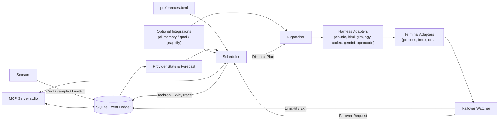
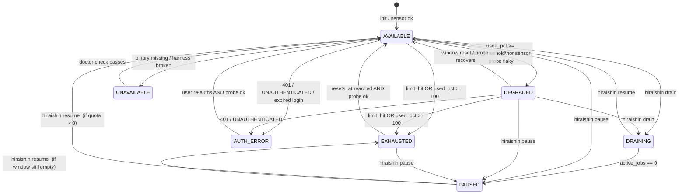
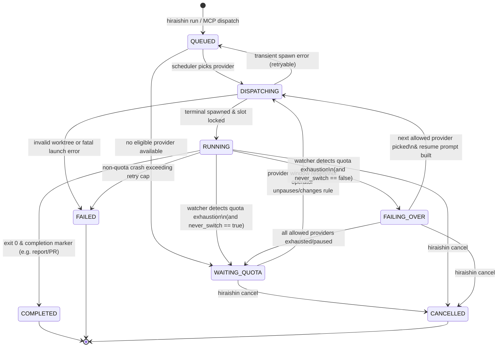
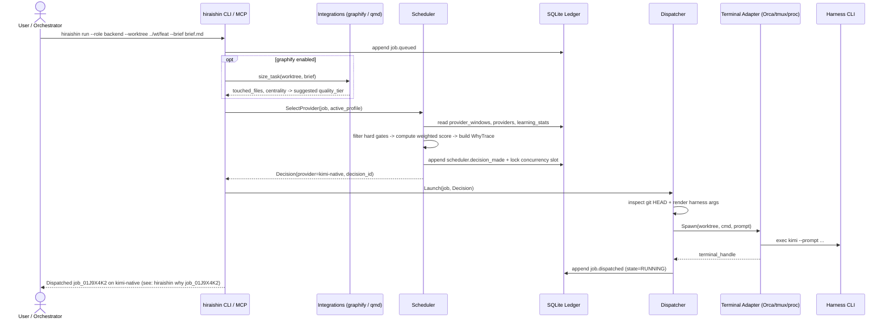
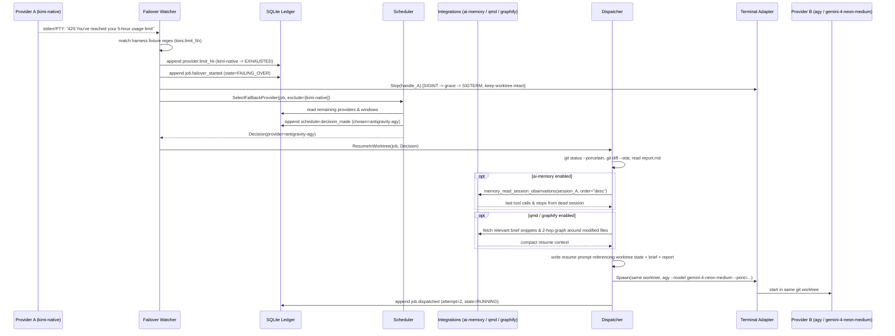
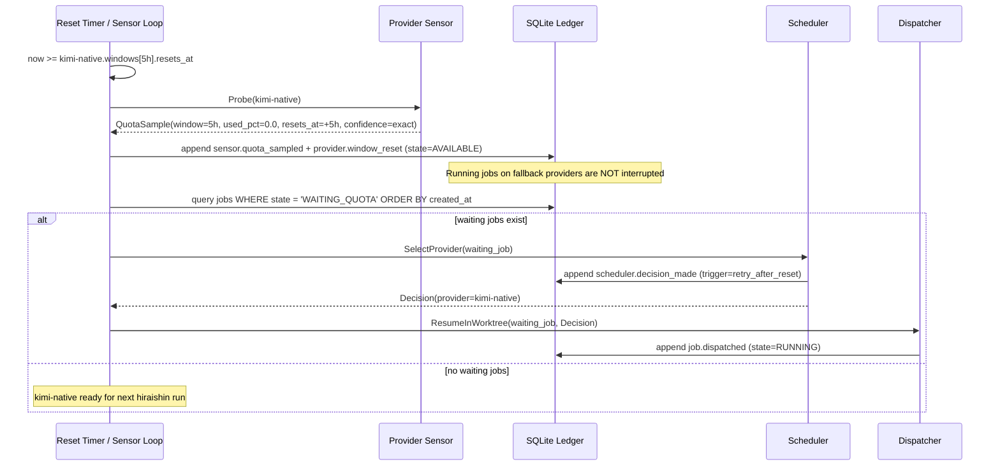

# Architecture

`hiraishin` is a local-first Go daemon and CLI ([ADR 0002](adr/0002-go-single-binary.md)) backed by an append-only SQLite event ledger ([ADR 0003](adr/0003-sqlite-event-ledger.md)). It never proxies model traffic ([ADR 0001](adr/0001-no-proxy.md)): every coding agent runs natively in its own official CLI (or user-configured harness such as OpenCode), inside a git worktree that serves as the recovery checkpoint ([ADR 0004](adr/0004-worktree-as-checkpoint.md)).

## Pipeline Overview

## Components

| Component | Package | Responsibility |
|---|---|---|
| **Sensors** | `internal/sensor` | Collect quota utilization, reset timestamps, and rate-limit signals from a provider using a tiered reliability chain (first-party usage endpoint -> local CLI logs/DB -> terminal output regex with recorded fixtures -> local token estimator). Never scrapes web cookies or proxies inference. |
| **Event Ledger** | `internal/ledger` | Append-only SQLite store (WAL mode, pure-Go `modernc.org/sqlite`). Persists every sample, decision, `why` trace, job transition, failover, and outcome. Projections (`provider_windows`, `jobs`, `learning_stats`) are rebuilt or updated transactionally from events. |
| **Forecast** (v0.2) | `internal/forecast` | Pure functions over recent `QuotaSample` events and active job counts. Computes exponentially weighted burn rate (`pct_per_hour`), `time_to_empty`, `time_to_reset`, and `perishable_waste_risk` (fraction of remaining window projected to expire unused before reset). |
| **Scheduler** | `internal/scheduler` | Evaluates hard policy gates (inventory enabled, concurrency cap, deny list, min quality tier, pin, cooldown) and scores eligible providers with the active objective profile plus bounded learned adjustments ([preferences.md](preferences.md)). Always emits a structured `Decision` with a human-readable `WhyTrace`. |
| **Dispatcher** | `internal/dispatch` | Prepares the job's git worktree, builds either the initial launch prompt or a failover resume prompt (pulling git status/diff, report file, and optional `ai-memory`/`qmd`/`graphify` context), selects the harness command line, and hands execution to a terminal adapter. |
| **Harness Adapters** | `internal/dispatch` (`harness.go`) | Provider-specific translators (`claude-code`, `kimi-native`, `glm-claude`, `opencode`, `antigravity-agy`, `codex`, `gemini-cli`). Encapsulate CLI flags for headless vs. interactive mode, session ID extraction, native resume flags, environment variables, and limit-error regex patterns. |
| **Terminal Adapters** | `internal/dispatch` (`adapter.go`) | Execution surfaces (`process` via `os/exec` in its own session, `tmux` window in session `hiraishin`, `orca` via `orca-ide terminal create`). Each runs the same per-attempt `run.sh` wrapper, which records the process group, tees `output.log` and writes the exit code, so `Stop` (SIGINT, SIGTERM, SIGKILL on the group) and output tailing are uniform across adapters. |
| **Failover Watcher** | `internal/watch` | Subscribes to terminal output streams and process exit codes for every running job. Matches harness-specific limit/auth/quota error patterns, records a `provider.limit_hit` event, marks the window `EXHAUSTED`, stops the stalled process cleanly (preserving uncommitted files), and triggers re-scheduling on the next allowed provider unless `never_switch_mid_task` is set. |
| **Engine** | `internal/engine` | Glue used by the CLI and the watcher: opens config + ledger, syncs configured providers, emits maintenance events (cooldown recovery, window resets), turns scheduler decisions into ledger events and launches attempts. |
| **MCP Server** (v0.2) | `internal/mcp` | Local stdio MCP server exposing read-only status (`hiraishin_status`, `hiraishin_why`, `hiraishin_forecast`) and orchestration actions (`hiraishin_pick_provider`, `hiraishin_dispatch`, `hiraishin_pause`, `hiraishin_drain`, `hiraishin_pin`) so a supervisor agent can coordinate fleets without shelling out. |

### Key Scheduling Invariants

1. **No mid-task switching unless exhausted.** Prompt caches are per-model and switching models mid-stream wastes context and causes drift. A running job stays on its assigned provider until completion, cancellation, or provider exhaustion.
2. **Reset returns new work only.** When an exhausted provider's window resets, it transitions back to `AVAILABLE` and becomes eligible for newly dispatched jobs (and future failovers); already-running jobs on a fallback provider are not disrupted.
3. **Bounded concurrency per provider.** Each provider has an explicit `max_concurrent` slot cap enforced atomically in the ledger transaction before launch.

## Data Model (SQLite)

Database path: `${XDG_DATA_HOME:-~/.local/share}/hiraishin/ledger.db` (WAL mode, `busy_timeout = 5000`, `foreign_keys = ON`).

### `events` (append-only source of truth)

| Column | Type | Constraints | Description |
|---|---|---|---|
| `seq` | `INTEGER` | `PRIMARY KEY AUTOINCREMENT` | Strictly monotonic event sequence number |
| `event_id` | `TEXT` | `NOT NULL UNIQUE` | ULID for idempotency and external references |
| `ts` | `TEXT` | `NOT NULL` | RFC3339Nano UTC timestamp |
| `kind` | `TEXT` | `NOT NULL` | Event type (see Event Types below) |
| `provider_id` | `TEXT` | `NULL` | Provider identifier (e.g. `claude-max`, `kimi-native`) |
| `job_id` | `TEXT` | `NULL` | Job ULID when event relates to a job |
| `source` | `TEXT` | `NOT NULL` | Origin (`sensor:endpoint`, `sensor:log`, `watcher:regex`, `scheduler`, `cli`, `mcp`) |
| `payload_json` | `TEXT` | `NOT NULL` | Canonical JSON payload for `kind` |

Indexes: `idx_events_ts(ts)`, `idx_events_provider_ts(provider_id, ts)`, `idx_events_job_ts(job_id, ts)`, `idx_events_kind_ts(kind, ts)`.

### `providers` (materialized provider state)

| Column | Type | Constraints | Description |
|---|---|---|---|
| `provider_id` | `TEXT` | `PRIMARY KEY` | Configured provider ID from `preferences.toml` |
| `harness` | `TEXT` | `NOT NULL` | Adapter name (`claude-code`, `kimi-native`, `opencode`, `antigravity-agy`, etc.) |
| `state` | `TEXT` | `NOT NULL` | `AVAILABLE`, `DEGRADED`, `DRAINING`, `PAUSED`, `EXHAUSTED`, `AUTH_ERROR`, `UNAVAILABLE` |
| `active_jobs` | `INTEGER` | `NOT NULL DEFAULT 0` | Count of currently running jobs on this provider |
| `max_concurrent` | `INTEGER` | `NOT NULL` | Configured concurrency limit |
| `cooldown_until` | `TEXT` | `NULL` | RFC3339 UTC timestamp when transient backoff ends |
| `last_error` | `TEXT` | `NULL` | Last matched limit/auth error snippet |
| `updated_at` | `TEXT` | `NOT NULL` | Last projection update timestamp |

### `provider_windows` (current rolling/fixed quota windows)

| Column | Type | Constraints | Description |
|---|---|---|---|
| `provider_id` | `TEXT` | `NOT NULL REFERENCES providers(provider_id)` | Owner provider |
| `window_name` | `TEXT` | `NOT NULL` | e.g. `5h`, `weekly`, `daily_rpd`, `rpm` |
| `window_kind` | `TEXT` | `NOT NULL` | `rolling`, `fixed_reset`, `credit_pool`, `metered` |
| `used_pct` | `REAL` | `NULL` | Observed utilization `0.0..100.0` (`NULL` if unknown) |
| `remaining_pct` | `REAL` | `NULL` | `100.0 - used_pct` when known |
| `resets_at` | `TEXT` | `NULL` | RFC3339 UTC expected reset timestamp |
| `burn_rate_pct_hr` | `REAL` | `NULL` | EWMA burn rate (`% / hour`) |
| `confidence` | `TEXT` | `NOT NULL` | `exact` (official endpoint), `estimated` (logs/tokens), `inferred` (limit hit only) |
| `sampled_at` | `TEXT` | `NOT NULL` | Timestamp of last sensor observation |

Primary key: `(provider_id, window_name)`.

### `jobs` (materialized job state)

| Column | Type | Constraints | Description |
|---|---|---|---|
| `job_id` | `TEXT` | `PRIMARY KEY` | ULID (`job_...`) |
| `name` | `TEXT` | `NOT NULL` | Human slug (e.g. `loot-drops`, `persist-all`) |
| `role` | `TEXT` | `NOT NULL` | Task role matching policy rules (e.g. `engine`, `ui`, `mechanical`, `docs`) |
| `state` | `TEXT` | `NOT NULL` | `QUEUED`, `DISPATCHING`, `RUNNING`, `FAILING_OVER`, `WAITING_QUOTA`, `COMPLETED`, `FAILED`, `CANCELLED` |
| `worktree_path` | `TEXT` | `NOT NULL` | Absolute path to git worktree checkpoint |
| `branch` | `TEXT` | `NOT NULL` | Git branch checked out in `worktree_path` |
| `brief_path` | `TEXT` | `NOT NULL` | Path to task brief |
| `report_path` | `TEXT` | `NULL` | Path to progress report file (checkpoint complement) |
| `current_provider` | `TEXT` | `NULL REFERENCES providers(provider_id)` | Provider currently executing the job |
| `terminal_adapter` | `TEXT` | `NOT NULL` | `process`, `tmux`, or `orca` |
| `terminal_handle` | `TEXT` | `NULL` | PID, tmux pane ID, or Orca terminal handle |
| `native_session_id` | `TEXT` | `NULL` | Harness session/conversation ID for resume or `ai-memory` lookup |
| `pinned_provider` | `TEXT` | `NULL` | Runtime pin override if set |
| `never_switch` | `INTEGER` | `NOT NULL DEFAULT 0` | Boolean: block automatic mid-task failover |
| `failover_count` | `INTEGER` | `NOT NULL DEFAULT 0` | Number of failovers completed |
| `created_at` | `TEXT` | `NOT NULL` | Creation timestamp |
| `updated_at` | `TEXT` | `NOT NULL` | Last state change timestamp |

### `decisions` (explainable scheduling audit trail)

| Column | Type | Constraints | Description |
|---|---|---|---|
| `decision_id` | `TEXT` | `PRIMARY KEY` | ULID (`dec_...`) |
| `job_id` | `TEXT` | `NOT NULL REFERENCES jobs(job_id)` | Target job |
| `trigger` | `TEXT` | `NOT NULL` | `initial_dispatch`, `failover`, `retry_after_reset`, `dry_run` |
| `profile` | `TEXT` | `NOT NULL` | Active objective profile name |
| `chosen_provider` | `TEXT` | `NULL` | Selected provider (`NULL` if no eligible provider -> `WAITING_QUOTA`) |
| `candidates_json` | `TEXT` | `NOT NULL` | Full JSON array of every candidate's score breakdown and hard-gate pass/reject reasons |
| `summary` | `TEXT` | `NOT NULL` | Single-paragraph human explanation rendered by `hiraishin why` |
| `created_at` | `TEXT` | `NOT NULL` | Decision timestamp |

### `job_attempts` (per-provider execution segments)

| Column | Type | Constraints | Description |
|---|---|---|---|
| `attempt_id` | `TEXT` | `PRIMARY KEY` | ULID |
| `job_id` | `TEXT` | `NOT NULL REFERENCES jobs(job_id)` | Parent job |
| `attempt_num` | `INTEGER` | `NOT NULL` | 1-based attempt counter |
| `provider_id` | `TEXT` | `NOT NULL` | Provider used for this segment |
| `decision_id` | `TEXT` | `NOT NULL REFERENCES decisions(decision_id)` | Decision that selected this provider |
| `start_commit` | `TEXT` | `NULL` | `HEAD` SHA when attempt started |
| `end_commit` | `TEXT` | `NULL` | `HEAD` SHA when attempt stopped |
| `exit_reason` | `TEXT` | `NULL` | `completed`, `quota_exhausted`, `auth_error`, `process_error`, `timeout`, `user_stop` |
| `started_at` | `TEXT` | `NOT NULL` | Start timestamp |
| `ended_at` | `TEXT` | `NULL` | End timestamp |

### `learning_stats` (bounded per-(provider, role) outcome aggregates)

| Column | Type | Constraints | Description |
|---|---|---|---|
| `provider_id` | `TEXT` | `NOT NULL` | Provider ID |
| `role` | `TEXT` | `NOT NULL` | Task role |
| `samples` | `INTEGER` | `NOT NULL DEFAULT 0` | Completed outcome count |
| `completed_ok` | `INTEGER` | `NOT NULL DEFAULT 0` | Finished without human takeover |
| `avg_review_rounds` | `REAL` | `NOT NULL DEFAULT 0.0` | EWMA of review/fix rounds before merge |
| `avg_build_failures` | `REAL` | `NOT NULL DEFAULT 0.0` | EWMA of build/gate failures |
| `avg_duration_min` | `REAL` | `NOT NULL DEFAULT 0.0` | EWMA wall minutes to completion |
| `bounded_delta` | `REAL` | `NOT NULL DEFAULT 0.0` | Clamped adjustment in `[-max_delta, +max_delta]` |
| `frozen` | `INTEGER` | `NOT NULL DEFAULT 0` | `1` if frozen globally or for this pair |
| `updated_at` | `TEXT` | `NOT NULL` | Last update timestamp |

Primary key: `(provider_id, role)`.

## Event Types

Every mutation enters `events` first.

| Category | Event Kind | Producer | Key Payload Fields |
|---|---|---|---|
| Sensor | `sensor.quota_sampled` | Sensors | `window_name`, `used_pct`, `resets_at`, `confidence`, `raw_tokens` |
| Sensor | `sensor.probe_failed` | Sensors | `sensor_tier`, `error`, `http_status` |
| Provider | `provider.configured` | Engine (config sync) | `harness`, `max_concurrent` |
| Provider | `provider.degraded` | Watcher | `matched_pattern`, `excerpt`, `cooldown_until` |
| Provider | `provider.recovered` | Engine (cooldown expiry) | `previous_state` |
| Provider | `provider.limit_hit` | Watcher / Sensor | `window_name`, `matched_pattern`, `excerpt`, `estimated_reset_at` |
| Provider | `provider.auth_failed` | Watcher / Sensor | `http_status`, `excerpt` |
| Provider | `provider.window_reset` | Forecast / Sensor | `window_name`, `previous_state`, `resets_at_next` |
| Provider | `provider.paused` | CLI / MCP | `reason`, `by` |
| Provider | `provider.resumed` | CLI / MCP | `by` |
| Provider | `provider.draining` | CLI / MCP | `reason`, `by` |
| Runtime | `runtime.profile_set` | CLI | `profile`, `by` |
| Runtime | `runtime.prefer_set` / `runtime.prefer_cleared` | CLI | `role`, `expires_at`, `by` |
| Scheduler | `scheduler.decision_made` | Scheduler | `decision_id`, `trigger`, `profile`, `role`, `min_quality_tier`, `weights`, `chosen_provider`, `candidates`, `summary`, `earliest_reset_at`, `blocked_providers` |
| Job | `job.queued` | CLI / MCP | `name`, `role`, `worktree_path`, `branch`, `brief_path`, `size_tier` |
| Job | `job.dispatched` | Dispatcher | `attempt_id`, `provider_id`, `terminal_adapter`, `terminal_handle`, `start_commit` |
| Job | `job.spawn_failed` | Dispatcher | `decision_id`, `error`, `retryable` |
| Job | `job.session_detected` | Watcher | `native_session_id` |
| Job | `job.failover_started` | Watcher | `from_provider`, `reason`, `dirty_files`, `head_commit` |
| Job | `job.waiting_quota` | Scheduler | `earliest_reset_at`, `blocked_providers` |
| Job | `job.completed` | Watcher / CLI | `end_commit`, `duration_min`, `pr_url` |
| Job | `job.failed` | Watcher / CLI | `exit_code`, `reason` |
| Job | `job.cancelled` | CLI / MCP | `by`, `reason` |
| Job | `job.pinned` / `job.unpinned` | CLI | `provider` / `never_switch` |
| Learning | `learning.outcome_recorded` | CLI / MCP | `provider_id`, `role`, `success`, `review_rounds`, `build_failures`, `duration_min` |
| Learning | `learning.frozen` / `learning.unfrozen` | CLI / MCP | `scope` (`global` or `provider:role`) |

## State Machines

### Provider State Machine

State semantics:
- `AVAILABLE`: eligible for new dispatches and failovers.
- `DEGRADED`: still eligible (with optional penalty), approaching exhaustion or falling back to lower-confidence sensor.
- `DRAINING`: running jobs finish normally; no new jobs or failovers are assigned. Automatically settles into `PAUSED` once `active_jobs == 0`.
- `PAUSED`: operator-suspended; ignored by scheduler regardless of quota.
- `EXHAUSTED`: hard-blocked until `resets_at` passes and a lightweight check confirms recovery (or operator overrides).
- `AUTH_ERROR`: hard-blocked; requires human login refresh (`claude auth login`, `agy`, etc.). Never auto-retried in a tight loop.

### Job State Machine

## Sequence Diagrams

### 1. Normal Dispatch

### 2. Exhaustion Mid-Job & Worktree Failover

### 3. Window Reset & Queued Job Wakeup

