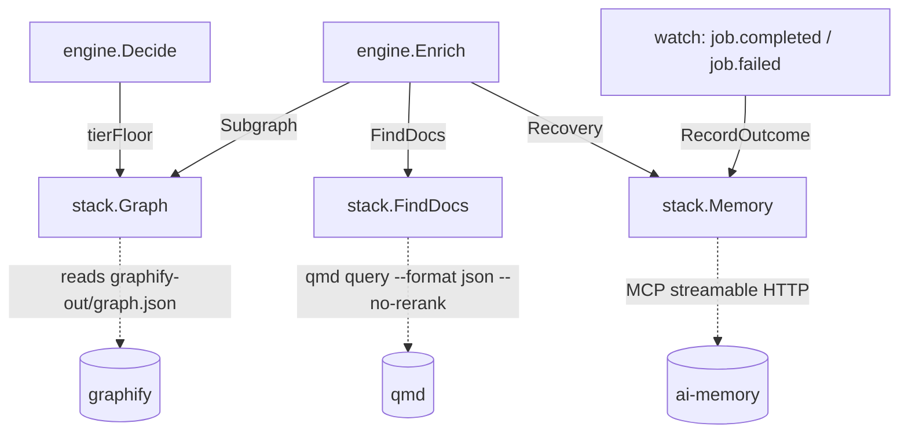

# Optional Stack Integrations (`ai-memory`, `qmd`, `graphify`)

`hiraishin` runs standalone with zero external dependencies beyond the target coding-agent CLIs and git. When `ai-memory`, `qmd`, or `graphify` are installed on the workstation, `hiraishin` uses them to enrich the prompts of new and resumed agents and to size tasks. Every integration is off by default, and each one degrades to a no-op when it is disabled, missing from `PATH`, unreachable, or timed out.

## Architecture



The adapters live in `internal/stack`; `internal/engine/enrich.go` wires them to jobs:

| Call | Where | What it adds |
|---|---|---|
| `Engine.Enrich(ctx, job, resume=false)` | `hiraishin run` and `watch` initial dispatch | `qmd` block |
| `Engine.Enrich(ctx, job, resume=true)` | `watch` failover to another provider | `ai-memory`, `qmd` and `graphify` blocks |
| `Engine.Decide` → `tierFloor` | every routing decision (`run`, `run --dry-run`, `watch`) | `graphify` task sizing |
| `Engine.RecordOutcome` | `watch`, after `job.completed` / `job.failed` | `ai-memory` outcome page |

When a provider resumes its own native session after a quota reset (the "continue" prompt), no enrichment is added: the agent still has its own context.

`Enrich` runs the three lookups concurrently under one 5 s budget and joins the non-empty blocks in a fixed order (recovery, docs, subgraph). The result goes into `PromptData.Enrichment`, which the built-in initial and resume templates print; a custom `resume_prompt_template` can use `{{.Enrichment}}`. Task sizing has a 2 s budget. Each block is fenced in a named tag and says that its content is data, not instructions.

When an integration is skipped, `hiraishin` writes one `debug` log line (`stack integration skipped integration=<name> err=...`) and never returns an error.

---

## 1. `ai-memory` (Session Recovery and Outcome Pages)

`ai-memory` runs locally as an MCP server (HTTP, e.g. `http://127.0.0.1:49374/mcp`). Its lifecycle hooks capture raw per-session observations (`user-prompt`, `post-tool-use`, `stop`, ...), including sessions that ended abruptly on a 429 without `SessionEnd`.

### Client

`stack.Memory` is a minimal MCP client over streamable HTTP: `initialize`, `notifications/initialized`, then one `tools/call`. It accepts both `application/json` and `text/event-stream` responses and forwards `Mcp-Session-Id`. Only `transport = "http"` is supported; any other transport is skipped with a debug note.

### Scope resolution

`hiraishin` is a static MCP client, so it passes `workspace` and `project` on every call. `stack.ResolveScope(worktree)`:

1. The nearest `.ai-memory.toml` at or above the worktree (`workspace` defaults to `default`).
2. Otherwise the `upstream`, then `origin` remote: the repository path without host and `.git`, lowercased, `/` replaced by `-` (`git@github.com:KurobaneShin/hiraishin.git` → `kurobaneshin-hiraishin`).
3. Otherwise the lowercased basename of the repository root.

### Cut-off session recovery (resume prompt)

The resume prompt already names the previous agent's native session id and tells the next agent to read it with `memory_read_session_observations`. That pointer only helps when the next harness has the `ai-memory` MCP. To cover harnesses without it, `Enrich` also reads the session server-side when the job has a `native_session_id`:

```
memory_read_session_observations(workspace, project, session_id=<native_session_id>, order="desc",
  limit=15, kinds=["user-prompt","post-tool-use","stop","notification"], body_max_chars=800)
```

It renders a `<previous-session-recovery session="...">` block, oldest first, each entry on one line and cut at 280 chars, the whole block capped at 2,500 chars (newest entries kept).

Not built: `memory_handoff_list` / `newer_unended_session` lookup (the ledger already records the native session id) and `memory_handoff_begin` (the session pointer plus the recovery block cover the same need).

### Outcome pages

With `record_outcomes = true`, `watch` calls `memory_write_page` after a job reaches `COMPLETED` or `FAILED`:

- `path`: `hiraishin/outcomes/<YYYY-MM-DD>-<job-name-slug>-<job_id>.md`
- `tier`: `episodic`, `kind`: `hiraishin-outcome`
- `tags`: `hiraishin`, `role:<role>`, and `provider:<id>` for every provider that ran an attempt
- `body`: `# Outcome: <job_name>` on line 1 (no `title` argument, avoiding `ai-memory` issue #67), then job id and role, result, worktree and branch, failover count, final commit, wall time, the provider chain with each attempt's exit reason, and the summary of every routing decision.

Query them with `memory_query(path_prefix="hiraishin/outcomes/", tag="role:gameplay")`. SQLite (`events`, `decisions`) stays the source of truth; the pages mirror outcomes for cross-session search. Review rounds and build failures are not in the page yet (they come from `hiraishin outcome record`, a separate v0.2 front).

### When `ai-memory` is absent

The HTTP call fails (connection refused) and the block or page is skipped. The resume prompt keeps the git state, report and session pointer.

---

## 2. `qmd` (One-Query Context Bundle)

`qmd` indexes local markdown into SQLite with BM25 (`lex`), vector (`vec`) and HyDE search. `hiraishin` uses only its CLI.

### Query

For every initial and resumed dispatch, `stack.FindDocs` runs one query against `integrations.qmd.collections`:

```bash
qmd query --format json --no-rerank --min-score 0.45 -n <max_snippets, default 5> -c orca -c mmorpg \
  $'intent: resume context for <job_name> (<role>)\nlex: <job_name> <role> <changed_file_basenames>\nvec: <brief goal>'
```

- `intent` drops the `resume` prefix on initial dispatch; `lex` lists changed files only on resume (up to 10 basenames); `vec` is the first 300 chars of the brief with Markdown heading marks removed.
- `lex` keeps only `[A-Za-z0-9._/-]` and strips leading `-`, so a file name cannot become a negated term.
- `--no-rerank` avoids the reranker model (GPU/CPU contention with local agents). The query embedding still runs on CPU; on the reference workstation one query took about 2.7 s, inside the 5 s budget.
- Hits that point at the job's own brief or report are dropped.

The `<related-docs>` block lists `qmd://<collection>/<path>:<line> (<title>, score <s>)` and up to 10 snippet lines per hit, ready for `qmd get <file>:<line>`.

`hiraishin` never runs `qmd embed` or `qmd update`; it reads the index as it is.

### When `qmd` is absent

`qmd` not on `PATH` → skipped before any process starts. A failing or empty query → no block. The prompt still links `brief_path` and `report_path`.

---

## 3. `graphify` (Task Sizing and Resume Subgraph)

`graphify` writes a knowledge graph to `graphify-out/graph.json` (NetworkX node-link JSON: `nodes` with `id`, `label`, `community`, `community_name`, `source_file`; `links` with `source`, `target`, `relation`). `hiraishin` reads that file directly; it never calls the `graphify` CLI or MCP server and never triggers a rebuild or LLM extraction.

The graph is looked up at the worktree's git top level, then at the main checkout (parent of `git rev-parse --git-common-dir`), because `graphify-out/` is usually untracked and lives only in the main checkout.

### Task files

- Files changed since the job's first attempt started (`git diff --name-only <first start commit>`, or `HEAD` before the first attempt) plus untracked files.
- For sizing only: every graph `source_file` whose path appears in the brief text.

### Task sizing (raises `min_quality_tier`)

With `enabled = true` and `auto_size_tier = true`, `Engine.Decide` computes `stack.Size` before Stage 1 gates:

- `touched_files`: task files that have nodes in the graph
- `communities_spanned`: distinct `community` values of those nodes
- `god_nodes`: those nodes among the top 10 by degree, excluding file-level nodes (label equal to the file name), like `graphify`'s `god_nodes`
- `blast_radius_edges`: sum of the degrees of those nodes

Rule (only raises, never lowers the role's `min_quality_tier`):

- any god node, or `communities_spanned >= 3` → at least tier `4`, or `5` when `blast_radius_edges >= 40`
- otherwise → the role's configured tier

A raised tier is stored in `decisions.min_quality_tier`, rejects lower-tier providers with the usual `quality_tier N < min_quality_tier M` reason, and appends to the decision summary shown by `hiraishin why` and `run --dry-run`, for example: `min_quality_tier raised from 3 to 4 by graphify (3 files; 3 communities; 4 edges).`

### Resume subgraph

On failover, `Graph.Subgraph` walks 2 hops (breadth first, undirected) from the nodes of the changed files and prints each edge once as `- <label> (<file>) <relation> <label> (<file>)`, inside a `<codebase-subgraph>` block that also lists the communities of the changed nodes. The block stays within `max_context_tokens` (default 1,500) at 4 chars per token; when it is full it ends with `- [...]`.

### When `graphify` is absent

No `graph.json` in either location → sizing returns no floor (the role's static `min_quality_tier` applies) and the subgraph block is omitted.

---

## Configuration

```toml
[integrations.ai_memory]
enabled = false
transport = "http"             # only "http" is supported
url = "http://127.0.0.1:49374/mcp"
record_outcomes = true

[integrations.qmd]
enabled = false
collections = ["orca", "mmorpg"]
max_snippets = 5

[integrations.graphify]
enabled = false
auto_size_tier = true
max_context_tokens = 1500
```

## Tests

| Integration | Enrichment test (mock) | Absent-tool test |
|---|---|---|
| `ai-memory` | `internal/stack/memory_test.go` (mock MCP HTTP server, SSE and JSON); `TestFailoverPromptCarriesStackContextAndRecordsTheOutcome` in `internal/watch` (recovery block and outcome page) | `TestMemoryUnreachableIsUnavailableAndFast`, `TestStdioTransportIsSkippedNotMisrouted` |
| `qmd` | `internal/stack/qmd_test.go` (fake `qmd` binary); `internal/watch` failover test | `TestFindDocsWithoutQmdIsUnavailableAndFast` |
| `graphify` | `internal/stack/graph_test.go`; `TestGraphSizingRaisesMinQualityTier` in `internal/engine`; `internal/watch` failover test | `TestLoadGraphAbsentIsUnavailable` |
| all three | `TestResumePromptCarriesAllThreeIntegrations` in `internal/engine` | `TestAbsentIntegrationsFallBackCleanly` in `internal/engine`: all three enabled but absent, empty enrichment, unchanged tier, only debug logs, total overhead under 50 ms |

## Summary Matrix: Enabled vs. Absent

| Integration | Used At | Primary Benefit | When Absent / Disabled |
|---|---|---|---|
| `ai-memory` | Failover + job end | Last captured steps of the cut-off session, even for harnesses without the MCP; outcome pages for cross-session recall | Resume uses git state, `report.md` and the session pointer; outcomes stay in SQLite |
| `qmd` | Initial dispatch + failover | One-query list of related docs without agent search turns | Prompt links `brief_path` and `report_path` only |
| `graphify` | Every decision + failover | Raises `min_quality_tier` for core or cross-community tasks; 2-hop subgraph around edits | Static role `min_quality_tier`; no subgraph block |
