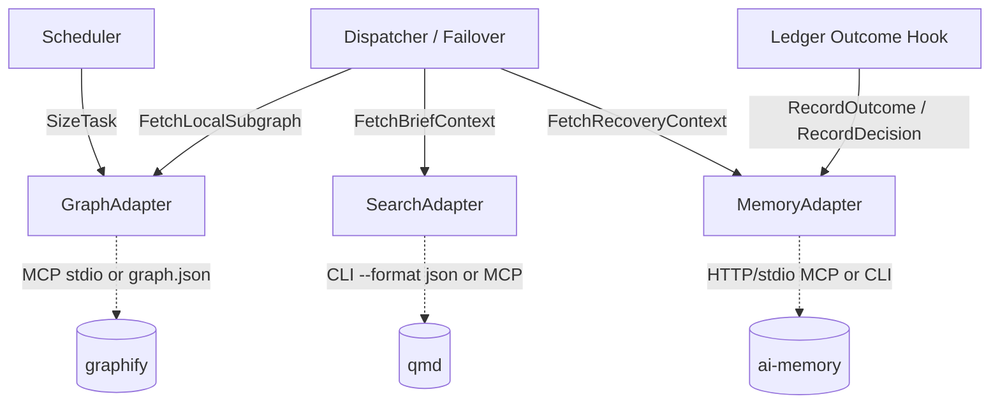

# Optional Stack Integrations (`ai-memory`, `qmd`, `graphify`)

`hiraishin` runs standalone with zero external dependencies beyond the target coding-agent CLIs and git. When `ai-memory`, `qmd`, or `graphify` are installed on the workstation, `hiraishin` integrates with them through narrow, optional Go adapter interfaces. Every integration degrades gracefully to a no-op if disabled, missing from `PATH`, unreachable, or timed out.

## Adapter Architecture



All three adapters obey a strict timeout budget (default `2s` for dispatch sizing, `5s` for failover context assembly) and treat every returned snippet as **untrusted data** fenced inside XML/Markdown blocks in generated resume prompts — never as executable instructions.

---

## 1. `ai-memory` (Session Recovery, Handoffs, and Decision History)

### What `ai-memory` Provides on This Stack

`ai-memory` runs locally (CLI `ai-memory` and MCP server over stdio or HTTP, e.g. `http://127.0.0.1:49375/mcp`). Its lifecycle hooks automatically capture raw per-session observations (`session-start`, `user-prompt`, `pre-tool-use`, `post-tool-use`, `stop`, `session-end`), manage single-use cross-agent handoffs, and maintain project wiki pages scoped by `.ai-memory.toml` (`workspace` + `project`).

Crucially for mid-task quota exhaustion, `ai-memory` tracks **unended sessions**: when a harness dies abruptly on a 429 or crash without firing `SessionEnd`, `memory_briefing` (`recent_sessions` with `ended: false`) and `memory_handoff_list` (`newer_unended_session`) identify the interrupted session, and `memory_read_session_observations` retrieves its last captured prompts, tool calls, and stops by UUID or native harness session ID (such as an OpenCode `ses_...` ID).

### Adapter Interface

```go
type MemoryAdapter interface {
    Available(ctx context.Context) bool

    // FetchRecovery pulls the last N observations of a cut-off session plus
    // any open handoff in the resolved (workspace, project) scope.
    FetchRecovery(ctx context.Context, req RecoveryQuery) (RecoveryContext, error)

    // WriteHandoff publishes a structured failover handoff so the resuming
    // agent's SessionStart hook (or explicit read) picks up seamlessly.
    WriteHandoff(ctx context.Context, req HandoffInput) (string, error)

    // RecordOutcome writes a durable episodic summary of a completed or failed
    // job and its provider routing history for user & learning queries.
    RecordOutcome(ctx context.Context, rec JobOutcomeRecord) error
}
```

### Concrete Flows

1. **Scope resolution:** Before any project-scoped call, the adapter reads the nearest `.ai-memory.toml` from `job.worktree_path` (falling back to normalized git remote path without host, then folder basename). Because `hiraishin` acts as a static MCP client, it always passes `workspace` and `project` explicitly on every project-scoped call.
2. **Building the failover resume prompt (cut-off session recovery):**
   - When `Failover Watcher` stops Provider A on quota exhaustion, `Dispatcher` calls `FetchRecovery`:
     1. Calls `memory_handoff_list(workspace, project)` to check for an open handoff and `newer_unended_session`.
     2. Calls `memory_read_session_observations(workspace, project, session_id=<native_session_id or newer_unended_session>, order="desc", limit=15, kinds=["user-prompt", "post-tool-use", "stop", "notification"], body_max_chars=800)`.
     3. Extracts the last edited files, last failing command/test (if any), and the agent's final stop message before hitting the quota wall.
   - `Dispatcher` injects a compact `<previous-session-recovery>` block (capped at 2,500 chars) into Provider B's resume prompt alongside `git status --porcelain`, `git diff --stat`, and `report.md`.
   - Optionally calls `memory_handoff_begin(workspace, project, cwd=worktree, summary=..., files_touched=..., next_steps=..., shared=true)` when launching a harness that supports `ai-memory`'s `SessionStart` hook (e.g. Claude Code, Codex, OpenCode), so the new session automatically receives the handoff block.
3. **Writing job outcomes and routing decisions:**
   - On `job.completed` or `job.failed` (when `integrations.ai_memory.record_outcomes = true`), `hiraishin` calls `memory_write_page` with:
     - `path`: `hiraishin/outcomes/<YYYY-MM-DD>-<job_name>-<job_id>.md`
     - `tier`: `episodic`
     - `kind`: `hiraishin-outcome`
     - `tags`: `["hiraishin", "role:<role>", "provider:<provider_id>"]`
     - `body`: `# Outcome: <job_name>` followed by provider chain (initial + failovers), decision `why` summary, review rounds, build failures, wall duration, and final commit/PR URL.
   - Note: `hiraishin` omits the `title` parameter and puts `# H1` on line 1 of `body` (avoiding `ai-memory` JSON-escaping issue #67).
   - Both the user ("how did `kimi-native` perform on `gameplay` tasks this week?") and future sessions can query these pages via `memory_query(path_prefix="hiraishin/outcomes/", tag="role:gameplay")`.
   - `hiraishin`'s SQLite `learning_stats` table remains the local source of truth for bounded learning math; `ai-memory` mirrors outcomes for cross-session search and auditability.

### Behavior When `ai-memory` Is Absent

- `Available()` returns `false` (HTTP endpoint unreachable or `ai-memory` binary missing).
- Failover builds the resume prompt purely from local git state (`git status`, `git diff --stat`, `git log origin/main..HEAD`), `brief_path`, and `report_path` ([ADR 0004](adr/0004-worktree-as-checkpoint.md)).
- Job outcomes and `why` traces remain fully stored in SQLite (`events`, `decisions`, `learning_stats`). No error is raised; a single `debug` log notes `ai-memory adapter skipped`.

---

## 2. `qmd` (Fast Context Lookup Across Briefs, Reports, and Plans)

### What `qmd` Provides on This Stack

`qmd` (Quick Markdown Search) indexes local markdown and code collections into SQLite (`~/.cache/qmd/index.sqlite`) with BM25 lexical search (`lex`), vector similarity (`vec`), hypothetical-document search (`hyde`), and optional reranking. It exposes both a scriptable CLI (`qmd query`, `qmd search`, `qmd get`, `qmd multi-get` with `--format json --no-rerank`) and an MCP stdio server (`qmd mcp` with `query`, `get`, `multi_get`, `status`).

On the user's workstation, `qmd` already maintains collections including `orca` (briefs/reports), `mmorpg` (`AGENTS.md`, `GLOSSARY.md`, `docs/**/*.md`), and `memorias`.

### Adapter Interface

```go
type SearchAdapter interface {
    Available(ctx context.Context) bool

    // FindJobContext retrieves the top relevant snippets from configured
    // collections (briefs, reports, architecture docs, gotchas) in one query.
    FindJobContext(ctx context.Context, req ContextQuery) ([]DocSnippet, error)
}
```

### Concrete Flows

1. **One-query context bundle for resumed agents:**
   - When failing over a job (or launching a fresh job whose brief references specs/gotchas across the repo), `Dispatcher` runs a single fast query against configured collections (`integrations.qmd.collections`):
     ```bash
     qmd query --format json --no-rerank --min-score 0.45 -n 5 \
       -c orca -c mmorpg \
       $'intent: resume context for <job_name> (<role>)\nlex: <job_name> <changed_files_basenames>\nvec: <brief_goal_summary>'
     ```
   - Using `--no-rerank` keeps latency under a few hundred milliseconds on CPU (avoiding GPU contention with local AI jobs).
   - `Dispatcher` filters out the job's own `brief_path` (already linked directly) and includes a compact list of `qmd://` references + 10-line snippets (e.g., related ADRs, gotchas for modified subsystems, prior reports from sibling fronts) in the resume prompt.
   - Instead of the resumed agent burning 5–10 tool turns grepping `docs/` and `~/orca/briefs/`, it starts with the exact files and line numbers (`file.md:100:40`) ready to read.
2. **Collection freshness:** `hiraishin` never runs `qmd embed` or `qmd update` automatically during dispatch (to avoid CPU/GPU spikes); it reads the existing index as-is.

### Behavior When `qmd` Is Absent

- `Available()` returns `false` if `qmd` is not on `PATH` or the configured collections do not exist.
- `Dispatcher` falls back to passing `brief_path` and `report_path` directly in the launch/resume prompt.
- Zero failure, zero delay.

---

## 3. `graphify` (Task Sizing for Quality Tier & Compact Subgraph Context)

### What `graphify` Provides on This Stack

`graphify` turns a codebase into a persistent knowledge graph at `graphify-out/graph.json` (AST extraction for code plus optional semantic extraction for docs), computing community clusters, god nodes (highest-degree core abstractions), shortest paths, and PR/file impact. It exposes CLI commands (`graphify path`, `graphify explain`) and an MCP stdio server (`query_graph`, `get_node`, `get_neighbors`, `get_community`, `god_nodes`, `graph_stats`, `shortest_path`, `get_pr_impact`).

### Adapter Interface

```go
type GraphAdapter interface {
    Available(ctx context.Context, repoRoot string) bool

    // EstimateComplexity inspects the files mentioned in a brief or modified
    // in a worktree against graphify-out/graph.json to estimate task blast radius.
    EstimateComplexity(ctx context.Context, repoRoot string, files []string) (TaskSizeEstimate, error)

    // ResumeSubgraph returns a token-budgeted neighborhood around modified files
    // so a resumed agent understands callers/callees without re-reading the repo.
    ResumeSubgraph(ctx context.Context, repoRoot string, files []string, tokenBudget int) (string, error)
}
```

### Concrete Flows

1. **Task sizing to pick or raise the quality tier (before Stage 1 hard gates):**
   - When `integrations.graphify.auto_size_tier = true` and `<repoRoot>/graphify-out/graph.json` exists:
     - `Scheduler` extracts target file paths/symbols from the job's brief (or `git diff --name-only` on failover) and queries the local graph (`god_nodes`, `get_neighbors`, community count).
     - `EstimateComplexity` computes:
       - `touched_files`: count of files referenced/modified
       - `communities_spanned`: number of distinct graph communities touched
       - `touches_god_node`: whether any target node is in the top-10 `god_nodes` (core abstraction with high fan-in/fan-out)
       - `blast_radius_edges`: count of 1-hop incoming/outgoing edges across touched nodes
     - Tier escalation rule (only raises, never lowers the user's configured `min_quality_tier`):
       - `touches_god_node == true` OR `communities_spanned >= 3` -> raise `effective_min_quality_tier` to at least `4` (or `5` if `blast_radius_edges >= 40`).
       - Localized single-community change (`touched_files <= 3`, `communities_spanned == 1`, no god node) -> keep the role's configured `min_quality_tier` as-is (safe for lower-tier/faster providers like `glm-flash` or `kimi-native`).
     - The sizing inputs and resulting `effective_min_quality_tier` are recorded verbatim in `decisions.candidates_json` and printed by `hiraishin why`.
2. **Compact graph context on failover:**
   - During mid-task failover, instead of forcing Provider B to explore the entire repository from scratch, `Dispatcher` calls `ResumeSubgraph` (equivalent to `query_graph(mode="bfs", depth=2, token_budget=1500)` anchored on the modified files/symbols from `git diff --name-only`).
   - Appends a compact `<codebase-subgraph>` block (<= 1,500 tokens) listing the modified nodes, their direct callers/callees, and the community labels they belong to.
3. **Zero LLM cost in `hiraishin`:** `hiraishin` reads `graphify-out/graph.json` (or calls `graphify`'s read-only MCP/CLI query tools) and **never** triggers a full graph rebuild or LLM semantic extraction.

### Behavior When `graphify` Is Absent

- `Available()` returns `false` if neither `graphify-out/graph.json` exists in the repo/worktree nor the `graphify` MCP server is reachable.
- `Scheduler` uses the role's static `min_quality_tier` from `preferences.toml` directly (optionally logging a lightweight git file-count note if `git diff --name-only` is non-empty, without altering tiers).
- `Dispatcher` omits `<codebase-subgraph>` from the resume prompt.

---

## Summary Matrix: Enabled vs. Absent

| Integration | Used At | Primary Benefit | When Absent / Disabled |
|---|---|---|---|
| `ai-memory` | Failover + Job completion | Recovers last tool calls/stops from cut-off sessions (`ended: false`); logs outcomes for cross-session recall | Resume uses git state + `report.md` only; outcomes remain in SQLite ledger |
| `qmd` | Dispatch + Failover | One-query lookup of briefs, ADRs, gotchas, and sibling reports without burning agent search turns | Resume links `brief_path` and `report_path` directly |
| `graphify` | Pre-schedule + Failover | Raises `min_quality_tier` when task touches god nodes or 3+ communities; injects 2-hop subgraph around edits | Uses static role `min_quality_tier`; omits subgraph block |
